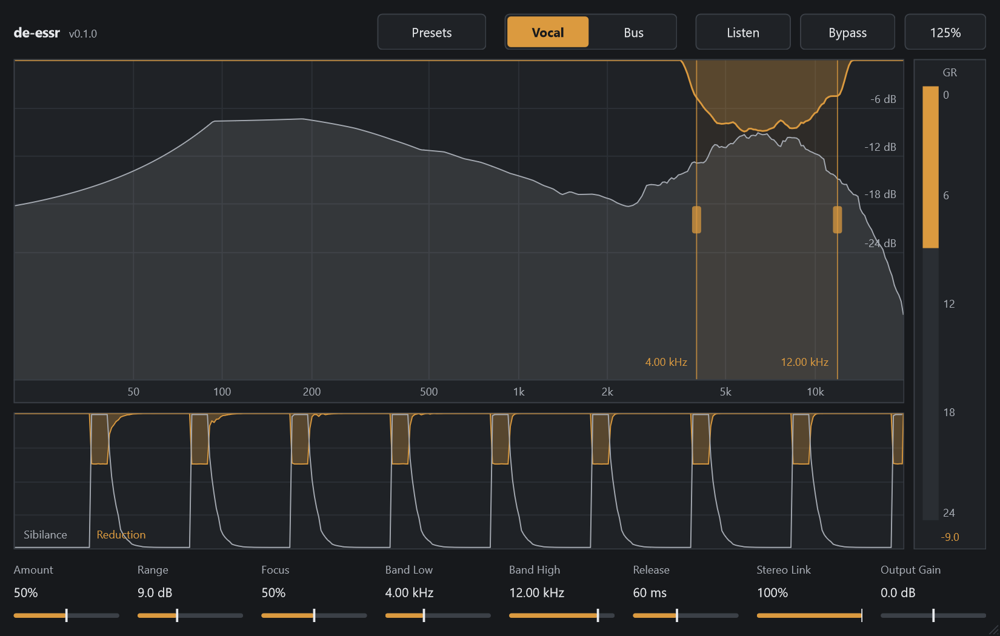

# de-essr

A de-esser plugin (VST3, Windows, 64-bit) that tames sibilance ("s", "sh", "z", "t") on sung vocals, spoken voice, and buses or full mixes.

It does not simply turn down a band of high frequencies when that band gets loud. It first decides whether the sound is sibilance, in a way that does not depend on how loud the track is, and then removes only the part of the spectrum that sticks out.



*The editor at 125% scale, processing a synthetic test signal (a harmonic tone followed by bursts of band-limited noise). The image is rendered from the real editor by the screenshot tool of this repository, see [Tools](#tests-and-tools).*

## How it differs from a simple threshold de-esser

A basic de-esser compares the level of a high-frequency band with a fixed threshold and lowers that band. Quiet sibilance stays below the threshold and is missed, loud passages are squashed, and the voice ends up dull or lispy.

de-essr works in two stages.

**1. Level-independent detection.** For each short frame the detector produces a value between 0 and 1. Every criterion is relative, never an absolute level:

- energy of the sibilant band compared with the energy below 3 kHz,
- level of the sibilant band compared with a slow reference of the level of the source,
- spectral shape (centroid, and a guard against isolated pure tones).

The same "s" is therefore detected the same way at -30 dBFS and at -10 dBFS, and a bright vowel is not mistaken for sibilance. Two modes are available:

- **Vocal**, for a single voice, uses the voiced / unvoiced criteria above.
- **Bus**, for a group or a full mix where those criteria mean nothing, reacts to what stands out from the long-term average of the sibilant band.

**2. Spectral reduction of the excess.** The signal is processed in the frequency domain (STFT, 75% overlap). During sibilant frames only, the plugin computes the smoothed spectral envelope and lowers what exceeds it:

- the reduction is capped by **Range** and never amplifies,
- **Focus** moves continuously from lowering the whole band to shaving only the peaks,
- a bin is never pushed below the long-term average of the non-sibilant source,
- gains are smoothed across frequency and time to avoid metallic artifacts and pumping.

A lookahead built into the latency puts the gain in place before the sibilant starts, so its onset is not let through.

## Controls

| Control | Range | Default | What it does |
| :- | :- | :- | :- |
| Mode | Vocal, Bus | Vocal | Detection mode, see above |
| Amount | 0 to 100% | 50% | Sensitivity, relative to the level of the source. At 0% the signal passes untouched |
| Range | 0 to 24 dB | 9 dB | Maximum reduction |
| Focus | 0 to 100% | 50% | 0%: the whole sibilant band goes down together. 100%: only the peaks are shaved |
| Band Low | 2 to 16 kHz | 4 kHz | Low edge of the sibilant band |
| Band High | 2 to 16 kHz | 12 kHz | High edge of the sibilant band |
| Release | 20 to 300 ms | 60 ms | How quickly the reduction lets go |
| Stereo Link | 0 to 100% | 100% | 100%: same gain on both channels, the stereo image does not move |
| Output Gain | -12 to +12 dB | 0 dB | Level of the processed signal |
| Listen | on, off | off | Outputs what is being removed instead of the processed signal |
| Bypass | on, off | off | Bypass that stays aligned with the reported latency |

All of them can be automated. In the editor:

- drag a control to change it, hold Shift for fine steps,
- double-click a control to return to its default,
- click a value to type it,
- drag the edges of the sibilant band directly on the spectrum,
- use the Presets button to load a factory preset (see below),
- use the button at the top right to set the interface scale (100% to 200%, 125% by default) and to show display diagnostics (detected refresh rate, average frame time, worst 1%),
- drag the bottom right corner to resize the window.

The scale and the window size are saved with the plugin state.

## Factory presets

The Presets button opens a menu of 42 starting points, grouped by kind of source. A preset sets Mode, Amount, Range, Focus, the sibilant band, Release and Stereo Link, and returns Output Gain to 0 dB. It never changes Listen or Bypass. The preset that matches the current settings is ticked in the menu.

The values come from common mixing practice (where sibilance usually sits for each source, and how much reduction stays natural). They were checked on synthetic signals, not tuned by ear on recordings: treat them as a first setting, then adjust Amount and Range with Listen on.

| Category | Presets | Mode |
| :- | :- | :- |
| Sung vocals | Default, Gentle, Firm, Heavy, Transparent Peaks Only, Female Lead, Male Lead, Bright Pop Lead, Rap Fast Delivery, Breathy and Airy, Whispered, Sh and Ch Sounds, Whistling S, After Heavy Compression, Backing Vocals, Doubles and Harmonies | Vocal |
| Spoken voice | Podcast Natural, Podcast Firm, Voice-over Male, Voice-over Female, Audiobook Narration, Dialogue Lavalier, Stream Headset Mic, Phone or Conference Call, Sharp T and D | Vocal |
| Effect sends | Before Reverb, Before Delay, Before Saturation | Vocal |
| Instruments | Hi-Hat, Drum Overheads, Acoustic Guitar String Squeak, Electric Guitar Pick Attack, Strings Bow Harshness, Brass Edge, Harsh Synth | Bus |
| Buses and master | Vocal Bus, Drum Bus, Mix Bus Light, Mix Bus Standard, Master Transparent, Master Vinyl Prep, Wide Stereo Unlinked | Bus |

A few notes on how they are built:

- the band follows the source: lower for male voices and "sh" sounds (2.5 to 9 kHz), higher for female voices, "t" and "d" consonants and cymbals (6 to 15 kHz),
- lead vocals keep Focus around the middle, stacked vocals and effect sends use a wide cut with a larger Range, because an "s" multiplied by voices, reverb or delay is far more audible,
- buses and masters use small Ranges (2 to 6 dB) and slower Releases,
- Wide Stereo Unlinked sets Stereo Link to 0%, for sources where sibilance sits on one side only.

The presets are defined in one table, `src/dsp/FactoryPresets.cpp`. They are not exposed as host programs, so a host can never overwrite your settings by recalling a program: your settings are saved and restored with the project as usual.

## Latency and CPU load

The latency is constant, reported to the host, and never depends on the settings.

| Sample rate | Latency | CPU, one stereo instance, block of 512 |
| :- | :- | :- |
| 44.1 kHz | 768 samples, 17.4 ms | 0.63% of one core |
| 48 kHz | 768 samples, 16.0 ms | 0.68% of one core |
| 96 kHz | 1536 samples, 16.0 ms | 1.41% of one core |
| 192 kHz | 3072 samples, 16.0 ms | 2.84% of one core |

CPU figures were measured with the benchmark tool of this repository on the development machine. They will differ on other hardware. The plugin is meant for mixing: there is no low-latency mode for live use.

## Download

Releases are on the **Releases** page of the GitHub repository. Each release has two files:

- `de-essr-<tag>-windows-vst3.zip`, the plugin,
- `de-essr-<tag>-windows-vst3.zip.sha256`, its SHA-256 checksum.

To check the download, compare the checksum with the one you compute in PowerShell:

```powershell
Get-FileHash .\de-essr-<tag>-windows-vst3.zip -Algorithm SHA256
```

## Installation

1. Unzip the archive. It contains one folder named `de-essr.vst3`.
2. Copy that folder to `C:\Program Files\Common Files\VST3`. Windows asks for administrator rights.
3. Rescan plugins in your DAW.

The plugin is not code-signed. Windows or your DAW may show a warning the first time it is loaded.

## Building from source

Requirements:

- Windows 10 or 11, 64-bit
- Visual Studio 2022 or later, or the Build Tools, with the C++ workload
- CMake 3.22 or later
- Git, and an internet connection for the first configuration (JUCE and Catch2 are downloaded)

```powershell
cmake -S . -B build -A x64
```

```powershell
cmake --build build --config Release --parallel
```

```powershell
ctest --test-dir build -C Release --output-on-failure
```

The plugin is built to `build\DeEssr_artefacts\Release\VST3\de-essr.vst3`.

After each Release build, the bundle is also copied to the system VST3 folder by `scripts\install-vst3.ps1`. The script writes only `de-essr.vst3` and touches nothing else in that folder. If the folder is not writable, the build stops with a message: either run the build from a terminal opened as administrator, or configure with `-DDEESSR_COPY_AFTER_BUILD=OFF` and run the script yourself from an administrator terminal:

```powershell
powershell -ExecutionPolicy Bypass -File scripts\install-vst3.ps1
```

If the copy fails because a DAW has the plugin open, the script says so. Close the DAW and build again.

### CMake variables

| Variable | Default | Purpose |
| :- | :- | :- |
| `VST3_INSTALL_DIR` | `C:/Program Files/Common Files/VST3` | Where the bundle is copied after a Release build |
| `DEESSR_COPY_AFTER_BUILD` | `ON` | Set to `OFF` to skip that copy |
| `DEESSR_VERSION` | `0.1.0` | Plugin version, shown in the editor. The release workflow sets it from the release tag |
| `DEESSR_BUILD_PLUGIN` | `ON` | `OFF` builds only the DSP core, its tests and the benchmark, without downloading JUCE |
| `DEESSR_BUILD_TESTS` | `ON` | Build the tests |
| `DEESSR_BUILD_TOOLS` | `ON` | Build the tools listed below |

There are no environment variables, keys or accounts to configure.

## Tests and tools

The tests cover the DSP core with signals generated by the test code: a harmonic tone standing in for a vowel, band-limited noise between 5 and 9 kHz standing in for sibilance, and a synthetic backing track. No recorded audio is stored in this repository. They check, among other things:

- the same reduction at -10 and -30 dBFS, within 2 dB, and untouched voiced segments,
- reduction never above Range, never any gain,
- energy outside the sibilant band preserved,
- an exact null at Amount 0 and in bypass,
- processed signal plus Listen signal equal to the delayed input,
- measured latency equal to the reported latency at every sample rate,
- identical output whatever the block size,
- finite output on silence, DC, full-scale noise and invalid samples,
- every factory preset within the parameter limits, and behaving on a speech-like signal.

Tools, built with the plugin and not shipped:

| Target | Purpose |
| :- | :- |
| `DeEssrBench` | Measures the CPU load of the DSP core |
| `DeEssrHostCheck` | Loads a built `de-essr.vst3` the way a host does and checks layouts, latency, state and editor |
| `DeEssrScreenshot` | Renders the real editor off screen to a PNG file while a synthetic signal runs through the processor |

Known limits of the verification so far: the plugin has not been run through `pluginval`, and the detector constants were tuned on synthetic signals. Judge the result on real voices by ear, starting with Listen.

## Releases

Publishing a release on GitHub runs `.github/workflows/release.yml`, which builds the plugin on Windows, runs the tests, and attaches the archive and its checksum to the release. Running the workflow by hand (Actions, Release, Run workflow) builds the same archive and keeps it as a workflow artifact instead.

## Project structure

```
CMakeLists.txt               build description, pinned dependencies
src/dsp/                     DSP core, plain C++, no dependency on JUCE
  DeEsserEngine              STFT, lookahead, aligned bypass, Listen output
  SibilanceDetector          level-independent detection, Vocal and Bus modes
  SpectralReducer            per-bin gains that remove only the excess
  FactoryPresets             table of the factory presets
  BandLayout, Fft, Params    band weights, FFT, settings
src/plugin/                  JUCE processor, parameters, audio-to-editor data
src/ui/                      editor: spectrum, history, meter, controls, theme
tests/                       synthetic signals and Catch2 tests
tools/                       benchmark, host check, screenshot renderer
scripts/install-vst3.ps1     local installation of the bundle
.github/workflows/           release workflow
docs/screenshots/            images used by this file
```

## License

de-essr is released under the [GNU Affero General Public License v3.0](LICENSE).

It is built with [JUCE](https://juce.com) 8, used under the AGPLv3, and with the VST 3 SDK bundled with JUCE. Both have their own licenses. The tests use [Catch2](https://github.com/catchorg/Catch2) (Boost Software License). VST is a registered trademark of Steinberg Media Technologies GmbH.
